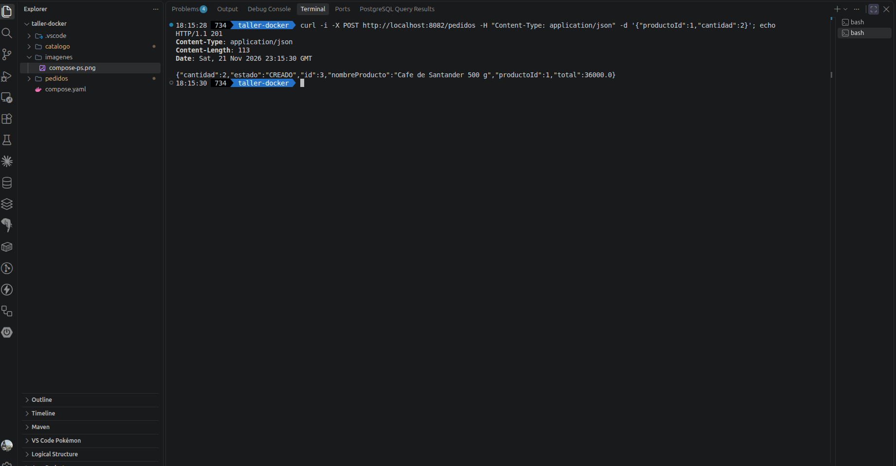
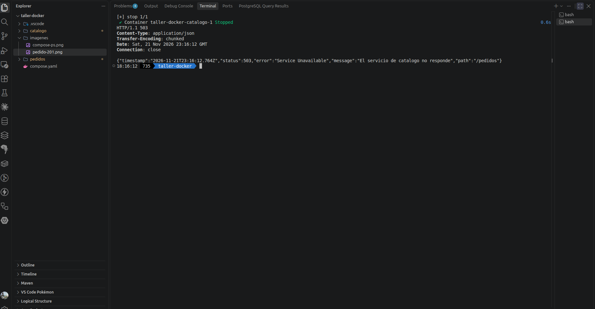
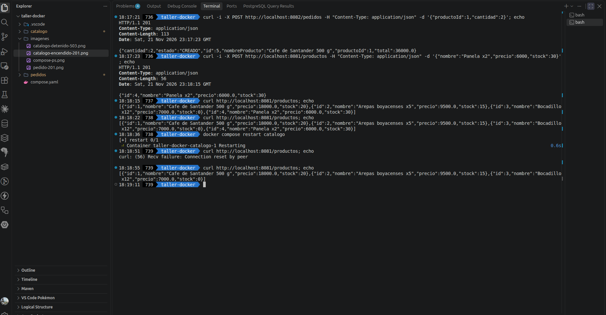
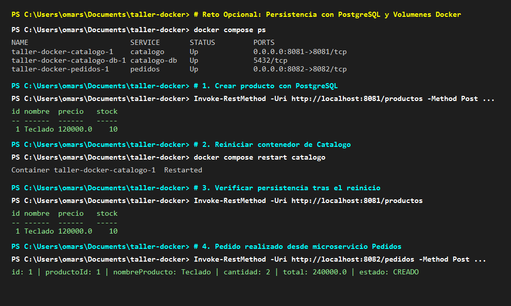

# Taller de Docker para microservicios

**Integrantes:** Camilo Andrés Sánchez Martínez (1152329) · Omar Fernando Suárez Oviedo (1152216)
**Materia:** Desarrollo de aplicaciones basadas en microservicios, UFPS

Los microservicios **Catálogo** (puerto 8081) y **Pedidos** (puerto 8082) del laboratorio anterior, empaquetados en contenedores y levantados juntos con Docker Compose.

## Contenido

| Archivo | Para qué sirve |
|---|---|
| `catalogo/Dockerfile` | Construye la imagen de Catálogo en dos etapas (Maven compila, luego solo Java 25 ejecuta) |
| `pedidos/Dockerfile` | Igual, para Pedidos (expone el 8082) |
| `catalogo/.dockerignore` y `pedidos/.dockerignore` | Evitan copiar `target/` y archivos del editor a la imagen |
| `compose.yaml` | Levanta los dos servicios en la misma red; Pedidos encuentra a Catálogo con `CATALOGO_URL=http://catalogo:8081` |

## Cómo ejecutarlo

```bash
docker compose up --build
```

Probar un pedido:

```bash
curl -i -X POST http://localhost:8082/pedidos -H "Content-Type: application/json" -d '{"productoId":1,"cantidad":2}'
```

## Evidencias

### Los dos servicios corriendo (`docker compose ps`)


### Pedido creado (201) con todo levantado en Compose


### Catálogo detenido: Pedidos responde 503


### Catálogo encendido de nuevo: el pedido vuelve a dar 201 sin reiniciar Pedidos


### El producto nuevo desaparece al reiniciar Catálogo (con H2 en memoria)


### Reto Opcional: Persistencia con PostgreSQL y Volúmenes de Docker
En este escenario se configuró el servicio `catalogo-db` (`postgres:16`) con el volumen persistente `catalogo-datos`. Tras crear el producto, reiniciar el contenedor `catalogo` y volver a consultar, el producto **permanece intacto**, demostrando la persistencia de datos. Además, el servicio `pedidos` interactúa correctamente con el producto persistido.


## Preguntas de análisis

### 1. ¿Por qué Pedidos no puede usar `localhost:8081` dentro de su contenedor? ¿Qué lo reemplazó?
Dentro de un contenedor, la dirección `localhost` (o `127.0.0.1`) hace referencia al propio contenedor y a su espacio de red aislado (*network namespace*), no a la máquina anfitriona ni a otros contenedores. Si Pedidos intentara comunicarse con `localhost:8081`, buscaría el puerto 8081 en su propio contenedor, donde no hay nada escuchando en dicho puerto, provocando un error de conexión (503 Service Unavailable).

Fue reemplazado por la **red interna creada por Docker Compose** y su servidor DNS integrado. En Compose, cada servicio puede resolverse usando directamente el nombre del servicio como hostname. Por ende, la URL pasó a ser:
`http://catalogo:8081`

### 2. ¿Qué ventaja tiene haber puesto la dirección de Catálogo en `application.properties` y no escrita en el código Java?
La principal ventaja es la **separación entre código y configuración** (siguiendo los principios de las aplicaciones *12-Factor App*):
- Evita tener que recompilar y reempaquetar la aplicación en caso de que cambie la IP, el puerto, el nombre del host o el entorno (desarrollo local vs. Docker vs. Kubernetes/producción).
- Permite la sobreescritura dinámica mediante **variables de entorno** en tiempo de ejecución. Spring Boot traduce automáticamente la variable de entorno `CATALOGO_URL` para sobreescribir la propiedad `catalogo.url` de `application.properties`, facilitando inyectar la configuración desde Docker Compose sin tocar una sola línea de código Java.

### 3. ¿Por qué el Dockerfile tiene dos etapas? ¿Qué pasaría con el tamaño de la imagen si fuera una sola?
El Dockerfile utiliza una estrategia de compilación multi-etapa (*multi-stage build*):
- **Etapa 1 (Build):** Usa una imagen base con Maven y el JDK completo para descargar dependencias y compilar el archivo `.jar`.
- **Etapa 2 (Runtime):** Parte de una imagen limpia y liviana que únicamente contiene el JRE (Java Runtime Environment) necesario para ejecutar el binario, copiando solamente el artefacto `.jar` resultante de la primera etapa.

Si fuera de una sola etapa:
- La imagen final arrastraría todo el JDK, las herramientas de compilación de Maven, los archivos fuente del proyecto y la caché local de dependencias (`~/.m2`).
- El tamaño de la imagen aumentaría drásticamente (pasando de ~200-300 MB a fácilmente 800 MB - 1.2 GB o más).
- Aumentaría la superficie de ataque y riesgos de seguridad en producción al incluir herramientas y fuentes innecesarias.

### 4. ¿Qué pasó con el producto que crearon después de reiniciar Catálogo? ¿Por qué? ¿Qué se necesitaría para que no se pierda?
El producto creado desapareció al reiniciar Catálogo. Esto se debe a que la aplicación utilizaba originalmente una base de datos en memoria (**H2** en modo in-memory). El ciclo de vida de los datos almacenados en memoria está estrictamente ligado al ciclo de vida del proceso de la aplicación: al reiniciar o detener el contenedor, la memoria se libera y los datos se pierden, volviendo a cargarse únicamente los datos iniciales de prueba (por ejemplo, desde `data.sql`).

Para que no se pierda la información se requiere:
1. Utilizar un motor de base de datos persistente (como PostgreSQL o MySQL) o una base de datos embebida basada en archivos.
2. Configurar un **volumen de Docker** (`volumes` en Docker Compose) vinculado al directorio donde el motor de base de datos guarda los datos en disco (`/var/lib/postgresql/data`), garantizando la persistencia incluso si los contenedores se destruyen o reinician.

### 5. `depends_on` arranca Catálogo antes que Pedidos. ¿Garantiza eso que Catálogo ya esté listo para responder cuando Pedidos recibe su primer pedido?
**No, no lo garantiza.** 
Por defecto, la directiva `depends_on` de Docker Compose solo espera a que el contenedor de destino (Catálogo) esté en estado de ejecución (*running* a nivel del daemon de Docker), es decir, que el proceso Java haya iniciado. No espera a que la aplicación Spring Boot termine de inicializar el contexto de Spring, abrir los sockets ni exponer el puerto HTTP para atender solicitudes.

Si Pedidos arranca rápido y recibe una petición antes de que Catálogo termine completamente su proceso de inicio (que suele tardar varios segundos), la llamada fallará con un error 503. Para garantizar que esté realmente listo, se necesitaría configurar un **healthcheck** en Catálogo (usando por ejemplo Spring Boot Actuator `/actuator/health`) y configurar en `depends_on` la condición `condition: service_healthy`.
