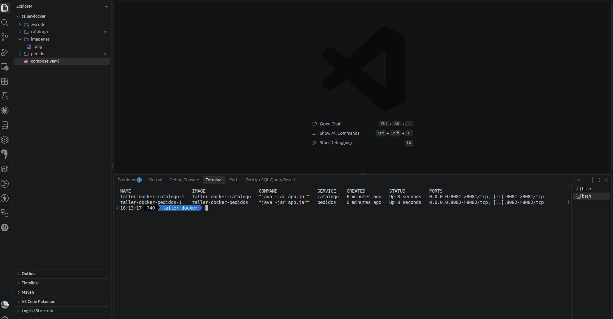
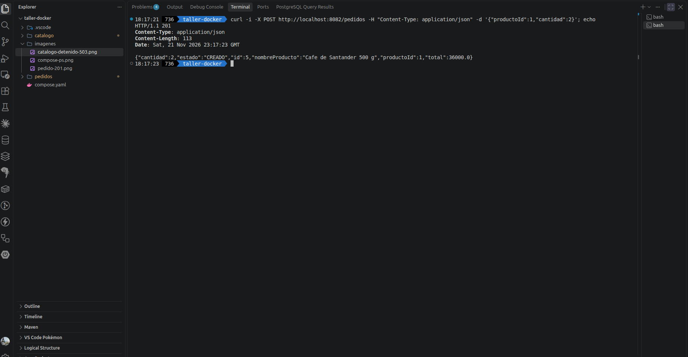

# Taller de Docker para microservicios

**Integrantes:** Camilo Andrés Sánchez Martínez (1152329) · Omar Fernando Suárez Oviedo (1152216)
**Materia:** Desarrollo de aplicaciones basadas en microservicios, UFPS

Los microservicios **Catálogo** (puerto 8081) y **Pedidos** (puerto 8082) del laboratorio anterior, empaquetados en contenedores y levantados juntos con Docker Compose.

## Contenido

| Archivo | Para qué sirve |
|---|---|
| `catalogo/Dockerfile` | Construye la imagen de Catálogo en dos etapas (Maven compila, luego solo Java 25 ejecuta) |
| `pedidos/Dockerfile` | Igual, para Pedidos (expone el 8082) |
| `catalogo/.dockerignore` y `pedidos/.dockerignore` | Evitan copiar `target/` y archivos del editor a la imagen |
| `compose.yaml` | Levanta los dos servicios en la misma red; Pedidos encuentra a Catálogo con `CATALOGO_URL=http://catalogo:8081` |

## Cómo ejecutarlo

```bash
docker compose up --build
```

Probar un pedido:

```bash
curl -i -X POST http://localhost:8082/pedidos -H "Content-Type: application/json" -d '{"productoId":1,"cantidad":2}'
```

## Evidencias

### Los dos servicios corriendo (`docker compose ps`)


### Pedido creado (201) con todo levantado en Compose


### Catálogo detenido: Pedidos responde 503


### Catálogo encendido de nuevo: el pedido vuelve a dar 201 sin reiniciar Pedidos


### El producto nuevo desaparece al reiniciar Catálogo


## Preguntas de análisis

### 1. ¿Por qué Pedidos no puede usar `localhost:8081` dentro de su contenedor? ¿Qué lo reemplazó?
### 2. ¿Qué ventaja tiene haber puesto la dirección de Catálogo en `application.properties` y no escrita en el código Java?
### 3. ¿Por qué el Dockerfile tiene dos etapas? ¿Qué pasaría con el tamaño de la imagen si fuera una sola?
### 4. ¿Qué pasó con el producto que crearon después de reiniciar Catálogo? ¿Por qué? ¿Qué se necesitaría para que no se pierda?
### 5. `depends_on` arranca Catálogo antes que Pedidos. ¿Garantiza eso que Catálogo ya esté listo para responder cuando Pedidos recibe su primer pedido?
